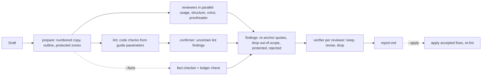

# Blog Style Guide Creator v2

*Status: locked. Approved by Tim Metz on 2026-11-09.*

## The problem

**How should blog-style-guide-creator be rebuilt so that it loads on current Claude Code, checks any brand's guide without leaking one brand's rules into another, and uses the Claude 5 models well?**

Version 1, the plugin The Workflow featured in April 2026<sup>[1](#sources)</sup>, no longer loads. Its marketplace entry lists commands and agents beside the plugin's own manifest, and Claude Code refuses that combination as "conflicting manifests"<sup>[2](#sources)</sup>. Fixing the manifest would expose deeper problems:

- **Paths:** commands read prompts from a bare `agents/` path and write guides to `brands/<name>/`, both relative to the user's working directory. An installed plugin lives in a cache folder that changes on every update, so the prompts are not found and anything written there is lost<sup>[2](#sources)</sup>.
- **One brand's rules in every agent:** the punctuation agent requires spaced em dashes and two agents require Title Case, so a brand that closes its dashes or uses sentence-case headings gets a false finding on every dash and heading.
- **Section-number routing:** each of eight agents reads one numbered section of the guide, so a guide ordered differently sends every agent to the wrong rules.
- **Invented evidence:** agents are asked for line numbers in an article they receive without them, and the guide generator reports consistency percentages nothing counts.
- **No model or tool limits:** no agent sets `model` or `tools`, so every checker can edit files and run shell commands on whatever model the session uses.

## The design scope

The design covers the whole plugin: four skills, a standard-library Python script for everything deterministic, eleven narrow agents, a guide format with stable rule IDs, a fictional demo brand, and eval suites. It adds four capabilities: fact-checking, proofreading, guide building from a brand kit or style document, and rule proposals learned from editors' edits.

It ends at the brand's own systems. A brand kit arrives through a connector the user already has, or as saved files; the plugin reads kits and never writes to them. Brand data lives outside the plugin, in a folder the user configures.

Noteworthy:

- **No hooks:** they would fire in every session, not only during a check.
- **No MCP server and no top-level `bin/`:** claude.ai and Cowork refuse plugins with a `bin/`<sup>[2](#sources)</sup>.
- **Python is required:** every skill stops with an install pointer when Python 3.9 or later is missing.
- **The public plugin ships no real brand's guide:** a fictional demo brand replaces the Animalz and We Eat Robots examples; the Animalz guide is compiled privately from its brand kit.

## High-level design

A **guide** is one Markdown file per brand. Each rule has a stable ID, a severity (`must`, `should`, `prefer`), a scope (all content or listed content types), a kind that decides which reviewer reads it, its evidence, and, where code can test it, a lint check with parameters. The format is defined once, in `skills/build-style-guide/schema.md`<sup>[3](#sources)</sup>.

**Checking a draft** (`style-check`) splits the work by what can settle it:



1. Code numbers every line of the draft and marks protected zones (code, block quotes, URLs, quoted speech).
2. Code runs every rule that has a check, with the guide's parameters, so the code holds no brand's preferences.
3. Four reviewers read the draft in parallel, each against its share of the guide; a small model answers yes or no on lint findings a pattern could not settle; with `--facts`, a fact-checker builds a ledger of claims with excerpts from saved pages.
4. Code drops any finding whose quote is not on its line, any finding out of scope or inside a protected zone, and any the brand rejected before.
5. A verifier reads each remaining reviewer finding with the rule's exact text and keeps, revises, or drops it.
6. Code writes the report; fixes apply only on request, to a copy.

**Building a guide** (`build-style-guide`) turns sources into candidate rules with evidence (article patterns counted by code, a brand document or kit read verbatim, editor edits grouped by change), merges them with the current guide into a proposal, and shows the user the diff. The guide changes only after approval; an auditor then reads it for contradictions and vague rules.

## Operational notes

### Success criteria

- [ ] `python3 -m unittest discover -s tests` passes on Python 3.9 and later
- [ ] `claude plugin validate --strict` passes for the plugin and the marketplace
- [ ] The plugin loads with four skills, two alias commands, and eleven agents
- [ ] `seeded-errors`: every planted error in the demo draft is reported, and every reported quote exists in the draft
- [ ] `brand-leakage`: the demo brand's clean articles produce no finding that only another brand's conventions would explain
- [ ] `v1-compat`: an eight-section 1.x guide produces a report
- [ ] `fact-check`: a link that does not support its sentence and a misspelled name are reported
- [ ] The private Animalz check of the three latest articles finds the known slips and no finding the kit does not support

### Risks

- **Heuristic checks:** the serial-comma and numerals checks are often uncertain and lean on the confirmer; the evals measure the false-positive rate.
- **Version floor:** `omitClaudeMd` and the userConfig types need Claude Code 2.1.271 or later; older versions are untested.
- **Ported code:** the fetch, extract, and ledger modules adapt internal Animalz scripts; publishing them is part of the push Tim approves.

## Details

### Layout

```
.claude-plugin/plugin.json        2.0.0; userConfig guides_dir, deep_model
skills/
  build-style-guide/              SKILL.md, sources.md, schema.md, upgrade-v1.md
  style-check/                    SKILL.md, apply.md, facts.md
  batch-review/SKILL.md
  validate-style-guide/SKILL.md
commands/                         generate-style-guide, update-style-guide (1.x aliases)
agents/                           eleven agents
scripts/sgc.py, scripts/sgclib/   the script and its modules
schema/                           JSON schemas for findings, verdicts, ledger, proposal
examples/demo-brand/              Acme Analytics: articles, guide, edit pair, seeded draft
evals/                            claude plugin eval suites
tests/                            unit tests for sgc
README.md, docs/usage.md, CHANGELOG.md
```

- **Paths:** skills and agents refer to bundled files through `${CLAUDE_PLUGIN_ROOT}`, which Claude Code substitutes in skill and agent text but does not set in the shell, so each command is written out in full<sup>[2](#sources)</sup>.
- **Brand folder:** `<guides_dir>/<brand>/` holds `style-guide.md`, `sources/` (`articles/`, `docs/`, `docs/kit/`, `edits/<pair>/`), `builds/<date>/`, and `decisions.jsonl`. `guides_dir` falls back to `${CLAUDE_PROJECT_DIR}/brands`, the 1.x location.
- **Run folder:** `<article folder>/<article name>.style-check/`, next to the draft.

### User configuration

| Key | Type | Default | Purpose |
|---|---|---|---|
| `guides_dir` | directory | none | Folder that holds brand folders |
| `deep_model` | string | `opus` | Model alias for guide building and auditing |

`deep_model` declares no `options` list, so versions that predate `options` still load the plugin. Skills pass it as the Agent call's `model`, which takes precedence over the agent's frontmatter<sup>[2](#sources)</sup>.

### Script

`scripts/sgc.py` runs on Python 3.9 or later with the standard library only. Every subcommand prints JSON; exit 2 means a missing or malformed input, exit 1 a failed check (`guide validate`, `ledger-check`, `fetch`). `sgc <command> --help` documents each one.

| Subcommand | Does |
|---|---|
| `brand-path` | Resolves the brand folder and guide, and reports the guide's schema version |
| `extract`, `fetch` | Convert a page to Markdown; save a page's text under a hash of its URL |
| `profile` | Counts lint patterns across source articles, with the same logic the checks use |
| `guide parse`, `validate`, `render`, `diff`, `checklist`, `index-v1` | Guide operations; `index-v1` reads a 1.x guide as rules `V1-N.M` |
| `kit-candidates` | Saved brand kit JSON into candidate rules, kit text verbatim |
| `prepare`, `packets`, `lint` | Run folder setup, one rule packet per reviewer, the lint checks |
| `findings`, `verdicts`, `report` | Filter and merge findings, apply verifier verdicts, write the report |
| `apply`, `decisions` | Apply accepted fixes bottom-up; record rejected findings |
| `diff-pairs`, `ledger-check` | Edit pairs into hunks; confirm fact excerpts on saved pages |

Every finding has one shape (`schema/finding.schema.json`): `rule_id`, `pass`, `line`, an exact `quote`, a `replacement` or a `comment`, and `basis` (`explicit` when the rule names the case, `inferred` when the reviewer applied its intent). Lint findings add `certainty`.

### Check rules

- **Lint findings skip the verifier.** Certain ones are settled by the pattern; uncertain ones go to the confirmer, and an answer of no drops them.
- **Protected zones** apply to reviewer findings. Lint checks read their own exclusions, and quoted speech is exempt from banned-term and dash checks. The proofreader's findings are dropped only in code, URLs, and frontmatter, because a typo inside a quote is still the writer's to fix.
- **Built-in pair check:** `sgc lint` also reports unclosed parentheses, square brackets, and bold markers (`PROOF-PAIR`) in every draft, per paragraph, list item, and heading, with code spans, URLs, and link targets masked. Unclosed quotation marks stay with the proofreader, since a quote may run across paragraphs on purpose.
- **Suggestions:** a `prefer` rule, or an `ai-drafting` rule on a human draft, reports as a suggestion.
- **Apply:** `auto` takes certain lint fixes; every other fix needs the user's choice; overlapping fixes are all refused; the result is linted again.

### Fact-check

The fact-checker lists every checkable claim and outbound link, fetches sources through `sgc fetch` into `facts/pages/`, and writes `facts/ledger.json`: one row per claim with the article quote, a verdict (`confirmed`, `contradicted`, `unsupported`, `unverifiable`, `link-dead`, `link-mismatch`), the source URL, and an excerpt copied from the saved page. `sgc ledger-check` confirms every excerpt on its page; a failing row goes back to the fact-checker once, and rows other than `confirmed` become `FACT-*` findings. A site that refuses the script's fetch (a 403 or a bot check, common on LinkedIn, Medium, and G2) makes a row `unverifiable`, never `link-dead`.

### Agents

Every agent sets `model`, `effort`, `tools`, and `omitClaudeMd: true`, which keeps a user's own CLAUDE.md writing preferences out of a check against someone else's guide.

| Agent | Model | Effort | Tools | Job |
|---|---|---|---|---|
| usage-checker | sonnet | medium | Read, Write | Sentence-level rules |
| structure-checker | sonnet | medium | Read, Write | Headings, sections, openings, endings, content-type rules |
| voice-checker | opus | high | Read, Write | Persona, tone, voice rules |
| proofreader | sonnet | medium | Read, Write | Objective errors under built-in `PROOF-*` IDs |
| mechanical-confirmer | haiku | low | Read, Write | Yes or no on uncertain lint findings |
| finding-verifier | opus; sonnet for proof and usage | high | Read, Write | Keep, revise, or drop each reviewer finding |
| fact-checker | sonnet | medium | Read, Write, Bash, WebSearch | The fact ledger |
| source-reader | sonnet | medium | Read, Write | Candidate rules from articles or a document |
| edit-miner | sonnet | medium | Read, Write | Candidate rules from edit hunks and rejections |
| guide-builder | `deep_model` | high | Read, Write | Merges candidates and the current guide into a proposal |
| guide-auditor | `deep_model` | high | Read, Write | Contradictions, vague rules, overlaps, check mismatches |

Prompts state each instruction once with its reason, without capitals for emphasis or reminders to double-check; the verifier is the independent check. Examples in prompts lean toward no brand.

### Building a guide

- **Precedence:** a brand kit or style document, then editor edits, then article patterns. An existing rule changes only when a source of equal or higher standing contradicts it.
- **Kit rules** keep the kit's text verbatim and the kit rule's ID as `source: kit:<id>`, so a re-import updates rules instead of adding copies. A kit rule that several checks can test becomes one rule per check (`source: kit:<id>#<check>`, holding the sentences that check covers) plus one `kit:<id>` rule for the rest. `guide render --existing` matches each part by its source and keeps its ID, severity, scope, kind, and check settings.
- **`--kit-only`** regenerates the whole guide from the kit and marks it generated; patterns from articles or edits become kit-rule proposals for the kit's owner.
- **Kit freshness:** a guide built from a kit records `kit_id` and the kit's `updated_at` in its frontmatter. `style-check` reads the live kit's `updated_at` when a kit connector is present and recommends a rebuild when the kit has changed since. The connector reports no published version number, so a draft edit can also trigger the recommendation.
- **Approval:** the user sees the diff (added, changed, kit text modified, retired), the conflicts the builder settled, and any kit proposals, and accepts all, none, or a list of IDs.

### Migration from 1.x

| 1.x | 2.0 |
|---|---|
| `/generate-style-guide`, `/update-style-guide` | `build-style-guide`; both names stay as commands for 2.x |
| `/style-check`, `/batch-review`, `/validate-style-guide` | Skills with the same names |
| Eight checker agents | `sgc lint` plus four reviewers and a verifier |
| style-guide-generator | source-reader, edit-miner, and guide-builder |
| `--auto-apply` | `--apply` |
| Marketplace entry with `commands` and `agents` | Plain entry; 2.0.0 in both manifests |

A 1.x guide keeps working: the tools read it through `guide index-v1`. `build-style-guide <brand> --upgrade` converts it, keeps its wording, and saves `style-guide.v1.md`.

### Alternatives and trade-offs

- **Eight LLM agents, one per section (1.x):** dropped. Section routing breaks on reordered guides, and models checking dash spacing are slower and less exact than code.
- **A separate mapping file for kit metadata:** dropped. The compiled guide's rule blocks carry the metadata, so the rules have one home.
- **Fetching articles through a summarizing web fetch:** dropped; it paraphrases, so punctuation and casing counts would be wrong.
- **A workflow script for batch review:** dropped; `batch-review` runs `style-check` per draft, which keeps one code path.
- **A model-only fallback without Python:** dropped. It would need a second pipeline for numbering, packets, and filtering; the skills stop and ask for Python instead.
- **A hand-maintained guide template:** dropped; `schema.md` and the demo guide cover the format, and a third copy would drift.
- **Cost of the design:** a check launches up to eight agents and a run folder per draft, and the plugin needs Python on the user's machine.

---
---

## AI context

### Decisions log

- 2026-11-09: Tim Metz approved the plan: AirOps kit 3609 is the source of Animalz rules; full rebuild; fact-check, proofreading, kit import, and learning from edits added; Animalz guide private, demo brand public.
- 2026-11-10: lint treats weekday and month names as proper nouns in sentence-case headings; `profile` counts numerals with the numerals check's own exclusions.
- 2026-11-10: kit rules covering several checks split by `kit:<id>#<check>`.
- 2026-11-10: the fact ledger is JSON (`facts/ledger.json`), pages in `facts/pages/`.
- 2026-11-10: Python is required; the model-only fallback is dropped.
- 2026-11-10, from an independent review Tim requested: blocked fetches become `unverifiable`; proofreading findings count inside quotes; compiled guides record the kit's `updated_at` for freshness checks; proof and usage findings are verified on Sonnet to cut the cost of a batch; the marketplace-install path joins the loading checks.
- 2026-11-10: unset userConfig values reach skill text as literal `${user_config.KEY}`; skills pass a setting to the shell only when it holds a real path.
- 2026-11-10: Tim Metz chose the private Animalz brand folder's location: `~/.claude-shared/voice/brands/animalz/`, with the shared voice guide's path a link to its `style-guide.md` and `guides_dir` set to `~/.claude-shared/voice/brands`.
- 2026-11-10: a quote mark opens a quoted item in a rule-block list only at the item's start, so phrases with apostrophes need no quoting.
- 2026-11-10: the end-to-end check's proofreader missed an unclosed parenthesis; Tim approved a code check for unclosed parentheses, brackets, and bold markers (`PROOF-PAIR`), which finds the one real case across the 14 Animalz articles and nothing else.

### Paths

- Plugin: `plugins/blog-style-guide-creator/` in `animalzinc/claude-plugins`
- Private reconciliation and the compiled Animalz guide's inputs: `animalz-intelligence-os/projects/internal/brand-kit-system/style-reconciliation-2026-11/`

### Sources

1. The Workflow, "The Claude Code Workflow that enforces your brand style guide", theworkflow.digital, 2026-04-02.
2. Claude Code documentation at code.claude.com: plugins reference, plugin marketplaces, subagents, and plugin eval pages, read 2026-11-09.
3. `plugins/blog-style-guide-creator/skills/build-style-guide/schema.md` in this repository.
